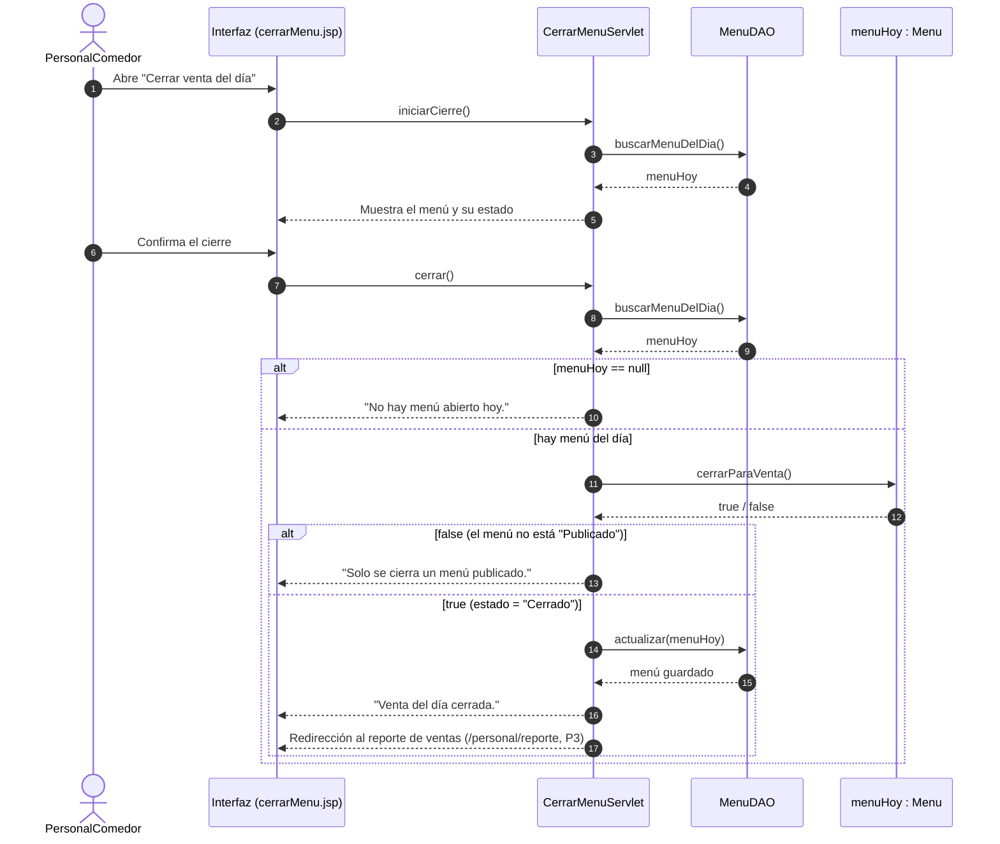

# Diagrama de secuencia – CU 05 Cerrar menú (cierre de la venta del día)

Actor: PersonalComedor. Precondición: el personal inició sesión (`FiltroPersonal`).
Los números de mensaje son los que cita el Javadoc de `CerrarMenuServlet`, `cerrarMenu.jsp` y `Menu.cerrarParaVenta()`.

## Mensajes

| N.º | Mensaje | Implementación |
| --- | --- | --- |
| 1 | Abre "Cerrar venta del día" | Tarjeta del `panel.jsp` → GET `/personal/cerrar-menu` |
| 2 | `iniciarCierre()` | `CerrarMenuServlet.doGet` → `iniciarCierre(request)` |
| 3-4 | `buscarMenuDelDia()` / menuHoy | `MenuDAO.buscarMenuDelDia()` (excluye menús "Cerrado") |
| 5 | Muestra el menú y su estado | `cerrarMenu.jsp`: sin menú, Borrador (sin botón) o Publicado (tabla + botón) |
| 6 | Confirma el cierre | Diálogo de confirmación de `cerrarMenu.jsp` → POST `accion=cerrar` |
| 7 | `cerrar()` | `CerrarMenuServlet.doPost` → `cerrar(sesion)` |
| 8-9 | `buscarMenuDelDia()` / menuHoy | Se vuelve a leer: el menú pudo cambiar desde el mensaje 5 |
| 10 | "No hay menú abierto hoy." | `flashError` y vuelve a `/personal/cerrar-menu` |
| 11-12 | `cerrarParaVenta()` / true\|false | `Menu.cerrarParaVenta()` (TDD T1: solo cierra un menú "Publicado") |
| 13 | "Solo se cierra un menú publicado." | `flashError` y vuelve a `/personal/cerrar-menu` |
| 14-15 | `actualizar(menuHoy)` | `GenericDAO.actualizar()` guarda el estado "Cerrado" |
| 16 | "Venta del día cerrada." | `flashExito` |
| 17 | Redirección al reporte | `sendRedirect("/personal/reporte")` → `ReporteVentasServlet` (P3) |

Efecto del cierre en el CU 03: `RealizarPedidoServlet.confirmar()` rechaza el pago con "El comedor ya cerró la venta de hoy." si el menú del día ya no está "Publicado".
